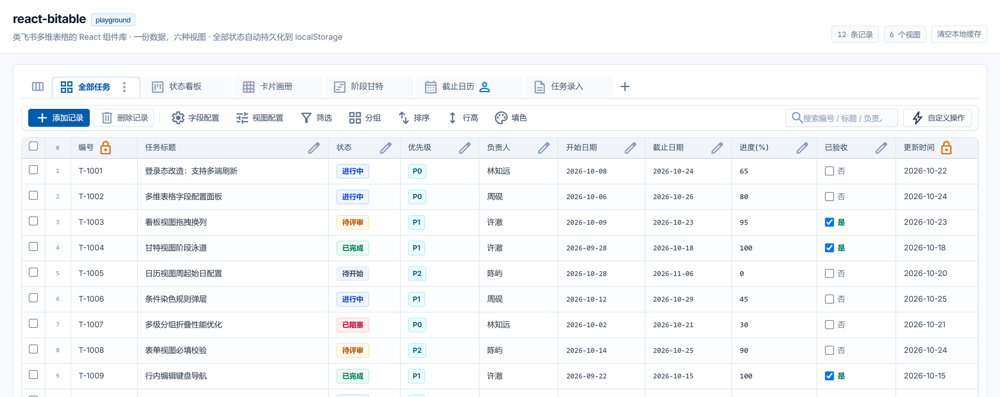
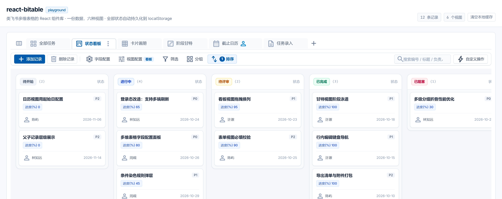
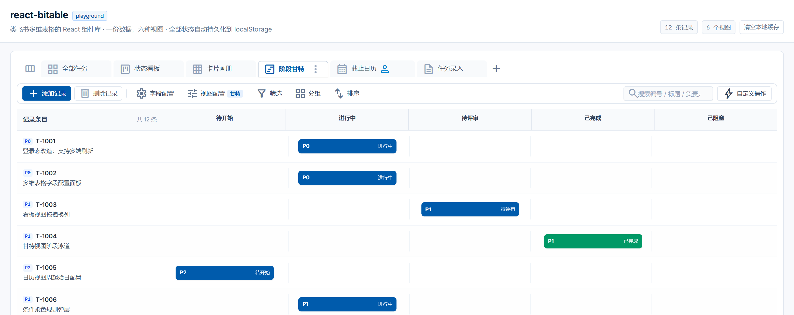
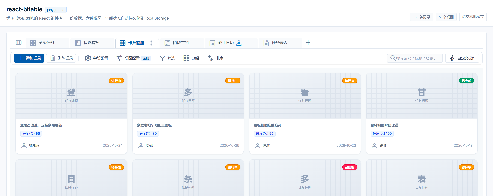

# react-bitable

[](https://github.com/DragonLuffy9527/react-bitable/actions/workflows/ci.yml)
[](LICENSE)

> A Feishu-Bitable-like multi-dimensional table for React. One dataset, six views, no backend.



| Kanban | Gantt |
| --- | --- |
|  |  |

| Gallery | Calendar / Form |
| --- | --- |
|  | run `npm run dev` |


`react-bitable` is a client-side multi-view table engine: a single `useBitable` hook owns state and
persistence, and a set of controlled components render it. Field configuration, filtering, sorting,
multi-level grouping, conditional coloring, inline editing, parent/child records and six view types
all work out of the box — data and configuration persist to `localStorage`.

- **Client only** — no server, no database, no auth. `npm run dev` and you're looking at it.
- **Controlled** — every write goes back through a callback, so you can wire it to REST, IndexedDB or a collab backend.
- **Tailwind driven** — appearance is 100% utility classes; theme via CSS variables.
- **Typed** — `BitableColumnConfig<T>` flows through, column ids match your row type.

## Features

| Area | Details |
| --- | --- |
| Views | grid / kanban / gallery / gantt / calendar / form — all sharing one view config |
| Fields | 7 field types, add / remove / rename / reorder / resize / lock / freeze |
| Filter & sort | AND / OR, 7 operators, multi-field sort |
| Grouping | nested groups with per-group and global collapse |
| Coloring | cell or row rules, palette + preset swatches |
| Editing | click-to-edit, Enter saves, Esc cancels, Tab moves |
| Hierarchy | drag the row handle to nest, expand / collapse parents |
| View management | create / rename / duplicate / delete / reset, collaborative vs personal, lockable |
| Persistence | rows, columns, views, active view and schema version all persisted |
| SSR safe | falls back to in-memory storage when `localStorage` is unavailable |

## Quick start

```bash
git clone https://github.com/DragonLuffy9527/react-bitable.git
cd react-bitable
npm install
npm run dev        # playground on http://localhost:5173
```

```bash
npm run build      # dist/index.js + dist/index.d.ts
npm run build:demo # static demo site
npm run typecheck  # tsc --noEmit
```

Styles require Tailwind CSS v4:

```css
@import 'tailwindcss';
@import 'react-bitable/styles.css';
```

## Minimal usage

```tsx
import { useBitable, BitableViewTabs, BitableToolbar, BitableTable } from 'react-bitable';

const { columns, views, activeView, activeViewId, groupedData, ... } = useBitable<Row>({
  storageKey: 'my-table',
  initialData: [],
  defaultColumns,
  presetViews
});
```

See [`playground/DemoApp.tsx`](playground/DemoApp.tsx) for a complete, wired-up example, and the
[Chinese README](README.md) for the full API reference (options, return values, persistence keys,
theming, limitations).

## Icons

Icons come from Google **Material Symbols Outlined**. Include the font in your page head:

```html
<link
  href="https://fonts.googleapis.com/css2?family=Material+Symbols+Outlined:wght,FILL@100..700,0..1&display=swap"
  rel="stylesheet"
/>
```

For offline / air-gapped use, self-host the font or swap the `<span className="material-symbols-outlined">`
nodes for your own icon component.

## Limitations

- Client-side only; multi-user collaboration needs your own backend.
- Column freezing (`isFrozen`) is persisted but not yet rendered.
- View-level column visibility (`visibleColumnIds` / `columnOrder`) is persisted but not consumed.
- No unit tests yet — regression is manual via the playground.

## License

[MIT](LICENSE) © 2026 DragonLuffy9527
